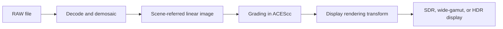
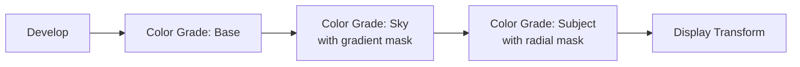

<p align="center">
  
</p>

<p align="center">
  <a href="https://aoraw.org/">Project website</a> · <a href="https://aoraw.org/zh-cn/">项目网页</a> · <a href="https://zidage.github.io/AlcedoStudio_docs/docs/intro">Documentation</a> · <a href="https://github.com/zidage/AlcedoStudio/releases/tag/v0.3.3">Download v0.3.3</a>
</p>

<p align="right"><a href="./README.md"><strong>English</strong></a> | <a href="./README.zh-CN.md">简体中文</a></p>


-lightgrey)

**Alcedo Studio** is a free and open-source RAW editor and photo library.

Import your photos to browse, rate, and search them within a single project, then develop RAW files in an end-to-end 32-bit floating-point GPU pipeline that handles large medium-format files without lag. The album structure and every photo's complete edit history stay inside one project file, making backups and moving libraries as simple as copying a standard file.

Supports Windows 10/11 (x64 with CUDA/OpenCL) and Macs with Apple Silicon (Metal).

<p align="center">
  
</p>

<details>
<summary><strong>Demo Video</strong> (two short videos)</summary>

Editor

https://github.com/user-attachments/assets/d70cd10d-2045-42f3-a67d-97ab3ef9874b

Library

https://github.com/user-attachments/assets/ae0d9773-220e-4901-90f6-1989f58b0462

</details>

## Key Features

- **Scene-Referred Node-Based Color Pipeline**  
  Operates entirely in a 32-bit floating-point scene-linear space with built-in ACES 2.0 and OpenDRT output transforms. Edits are structured as an intuitive node graph: a `Develop` node handles RAW decoding and color space transforms, followed by arbitrary `Color Grade` nodes with dedicated masks. Includes 113 film LUTs and supports custom 3D CUBE LUTs in any color space.

- **DAG-Based GPU Pipeline**  
  Edits are evaluated as a directed acyclic graph (DAG) in full 32-bit floating-point precision on native CUDA/OpenCL (Windows) and Metal (macOS). Each node and mask caches its output, so moving a slider only recalculates what comes after it rather than reprocessing the entire image. The preview updates in real time while dragging and settles to full quality on release. Zooming in only computes the visible region at 1:1 detail, eliminating the need to wait for offline proxies.

- **Local Asset Management (DuckDB & Local CLIP)**  
  Catalogs are backed by an embedded DuckDB engine for sub-millisecond filtering across massive libraries. An on-device multilingual CLIP model tags photos upon import for natural language search without cloud dependencies.

- **Branching Version History (Git-like DAG)**  
  Every adjustment is recorded in a non-linear version tree. Branch new variations from any step, undo changes permanently, or copy partial/complete Looks across images.

- **Full CLI & Agent Collaboration**  
  Every UI action—from culling and slider adjustments to branching history—maps 1:1 to `alcedo-cli`. Paired with [alcedo-skills](https://github.com/zidage/alcedo-skills), agents like Claude Code or Codex can run batch jobs headlessly or collaborate directly in the live window via a "preview → evaluate → adjust" loop.

## A Closer Look

### RAW Decode

Alcedo reads RAW files from Canon, Nikon, Sony, Fujifilm, Panasonic, OM System, Leica, Hasselblad, Phase One (including the 150 MP IQ4), Pentax, Sigma, and DNGs from phones and drones; see the lists of [supported formats](docs/supported_raw_formats.md) and [supported cameras](docs/supported_cameras.md). Through the project's [LibRaw fork](https://github.com/zidage/LibRaw), it also opens Nikon High Efficiency NEFs from the Z 8, Z 9, Z 6 III, and Z 50 II.

It offers two demosaicing methods. RCD is the default for Bayer sensors, and the Neural Engine, a compact neural network distilled from [DemosaicNet](https://groups.csail.mit.edu/graphics/demosaicnet/) that runs on the GPU, is the default for Fujifilm X-Trans and works with Bayer files as well. Alcedo also supports highlight reconstruction based on an improved inpaint-opposed method from darktable and RawTherapee, lens correction with Lensfun profiles, and the color profiles embedded in DNG files.

### Scene-Referred Color Pipeline

Alcedo keeps the full range of the RAW file through the whole edit and forms the picture for your display only at the last step:



For the display rendering transform, you can choose the ACES 2.0 output transform or OpenDRT, and set the target color space, transfer function, and peak luminance. On a Mac with an HDR display, the editor previews the HDR result directly.

### Node-Based Grading

Each photo's edit is a node graph. The Develop node turns the RAW into a scene-referred image, any number of Color Grade nodes follow in sequence, and the Display Transform node forms the final picture. Every Color Grade node carries its own adjustments and its own masks, so a grade can apply to the whole frame or only to the region you choose.



Each node provides standard tone and color controls, tone curves, Lift/Gamma/Gain color wheels, selective color, and detail tools. Shadows and highlights are handled by local tone mapping. Alcedo also includes [CUBE LUTs built from the spectral response of real film](https://github.com/JanLohse/spectral_film_lut), as well as physically modeled film grain and halation.

### LUTs in Any Color Space

Alongside the built-in film LUT pack, you can use your own 3D CUBE LUTs: drop them into the folder suggested by the LUT browser, and they appear under the "User" category. You can set the expected input encoding and resulting output encoding for each LUT. Scene encodings include ACES, ARRI LogC3 and LogC4, Fujifilm F-Log, Panasonic V-Log, Nikon N-Log, Apple Log, and DaVinci Intermediate; display encodings include sRGB, BT.1886, PQ, and HLG. When a LUT outputs a display encoding, Alcedo applies an ACES 2.0 inverse output transform to bring the result back into the scene space, allowing the LUT to integrate into the scene-referred pipeline like any other adjustment. Alcedo remembers encoding pairs per LUT and carries them when copying adjustments. The LUT browser supports filtering by category, source, brand, and print stock.

### Versions and Edit History

Each photo can store multiple named versions, or branch into a new version from any step in history. Adjustments are recorded in a Git-like history inside the project file, making every step reversible. You can copy an entire Look, or select specific adjustments, across photos. For architecture details, see the [edit history design notes](https://zidage.github.io/AlcedoStudio_docs/en/docs/developer/edit-history-architecture).

### Library and Search

The library is stored in a [DuckDB](https://duckdb.org/) database, keeping browsing, filtering, and search responsive as your collection expands. The album inspector groups photos by date, camera, lens, tag, and rating; selecting any group filters the catalog instantly.

Alcedo supports three search modes: EXIF queries by camera, lens, date, ISO, focal length, and aperture; natural-language search via on-device multilingual CLIP models that can also auto-tag on import; and full-text search across generated descriptions and tags.

It can also connect to your existing AI services via OpenAI- or Anthropic-compatible APIs to write photo descriptions and assign 1–5 star ratings with concise rationales. Rating strictness and language are configurable. API keys are stored securely in Windows Credential Manager or macOS Keychain, and analysis runs in the background.

### Export

Alcedo exports to JPEG, PNG, TIFF, OpenEXR, and Ultra HDR JPEG, supporting 8, 16, or 32 bits where applicable. Sizing can be defined by long edge, exact dimensions, or print size, with embedded ICC profiles and flexible filename patterns. Built-in presets (Standard, Web, Social Media, Email, Maximum Quality JPEG, 16-bit TIFF, and EXR Archive) configure all settings except destination, and custom presets can be saved. Metadata export options let you choose whether to retain EXIF, ICC profiles, and GPS coordinates. Camera/lens serial numbers and edit history are never written to exported files.

### AI Agents and alcedo-cli

alcedo-cli is installed alongside the application (inside the app bundle on macOS). Agents, shell scripts, or terminal users can perform any UI action through the CLI:

- **Projects and Library**: Create, open, and save projects; import folders; list, rate, select, and delete photos; inspect metadata and thumbnails; query via search rules including natural-language queries.
- **Editing**: Open photos, inspect and set any adjustment, update multiple fields atomically, manipulate nodes and LUTs, undo/redo, and read edit histories.
- **Versions**: Create, branch, switch, rename, and delete versions; copy and paste adjustments across photos.
- **Output**: Render previews for inspection, export using identical settings to the UI panel, and monitor background tasks until completion.

Agents operate in two modes. Headless sessions run in the background for batch workflows. Alternatively, an agent can take control of your active window: editing controls are locked during its operations while viewport panning, zooming, and scopes remain active. Agent sessions are pinned to the task island and background tasks dialog, listing executed commands; clicking Stop immediately returns control. Agent edits are badged in the history with rationales for easy review and rollback.

```sh
alcedo-cli session start --headless --project <project>.alcd
alcedo-cli call search.query '{"text": "sunset over the ocean"}'
alcedo-cli schema          # Parameter and result definitions per command
alcedo-cli session stop
```

Paired with the `alcedo` skill in [alcedo-skills](https://github.com/zidage/alcedo-skills), an agent establishes a "render preview → inspect frame → refine adjustments" loop, adapting edits dynamically to the image rather than applying static numbers. Install by telling your agent "Install the skill zidage/alcedo-skills", or in Claude Code via `/plugin marketplace add zidage/alcedo-skills` and `/plugin install alcedo@alcedo-skills`. New capabilities are added as lightweight Python scripts rather than compiled plugins. For example, `contact_sheet.py` generates contact sheets across hundreds of images in a single batch call for automated culling and rating, while `analyze_preview.py` measures tones, color casts, and horizon tilt, writing results directly back into the project. The complete [command reference](https://github.com/zidage/alcedo-skills/blob/main/skills/alcedo/references/README.md) is available in the same repository.

## Screenshots

<table>
  <tr>
    <td width="50%"></td>
    <td width="50%"></td>
  </tr>
  <tr>
    <td width="50%"></td>
    <td width="50%"></td>
  </tr>
  <tr>
    <td width="50%"></td>
    <td width="50%"></td>
  </tr>
</table>

## System Requirements

- **Windows**: 10 or 11, x64. Compute capability 6.0+ NVIDIA GPU for CUDA; OpenCL for other GPUs.
- **macOS**: 13.3 or later, Apple Silicon (M1 or newer), using Metal.
- Minimum 8 GB RAM; 16 GB or more recommended for large libraries.

## Documentation

User guides and developer notes are available on the [documentation site](https://zidage.github.io/AlcedoStudio_docs/docs/intro). For building from source, see [docs/build_from_source.md](docs/build_from_source.md). Release notes are located in [docs/changelog/](docs/changelog/). To control Alcedo Studio from scripts, terminals, or AI agents, refer to the [alcedo-cli documentation](https://github.com/zidage/alcedo-skills/blob/main/skills/alcedo/references/README.md).

## Acknowledgments

Alcedo Studio builds upon the work of many open-source projects and authors:

- Film simulation LUTs from [JanLohse/spectral_film_lut](https://github.com/JanLohse/spectral_film_lut) and [andreavolpato/spektrafilm](https://github.com/andreavolpato/spektrafilm).
- Camera color matrices from [rawtoaces-data](https://github.com/AcademySoftwareFoundation/rawtoaces-data).
- Neural demosaicing model distilled from [mgharbi/demosaicnet](https://github.com/mgharbi/demosaicnet) ([Gharbi et al., 2016](https://groups.csail.mit.edu/graphics/demosaicnet/)).
- Inpaint-opposed highlight reconstruction adapted from [darktable](https://github.com/darktable-org/darktable/blob/master/src/iop/hlreconstruct/opposed.c) and [RawTherapee](https://github.com/RawTherapee/RawTherapee/blob/dev/rtengine/hilite_recon.cc).
- RCD demosaicing adapted from [LuisSR/RCD-Demosaicing](https://github.com/LuisSR/RCD-Demosaicing).
- OpenDRT ported from Jed Smith's [open-display-transform](https://github.com/jedypod/open-display-transform).
- ACES 2.0 output transforms implemented according to [aces-aswf/aces-core](https://github.com/aces-aswf/aces-core).
- Film grain based on [Realistic Film Grain Rendering](https://doi.org/10.5201/ipol.2017.192) (IPOL 2017).
- RAW decoding uses [LibRaw](https://www.libraw.org/), lens correction uses [Lensfun](https://lensfun.github.io/), metadata uses [Exiv2](https://exiv2.org/), image IO uses [OpenImageIO](https://github.com/AcademySoftwareFoundation/OpenImageIO) and [OpenCV](https://opencv.org/), color management uses [OpenColorIO](https://opencolorio.org/), catalog database uses [DuckDB](https://duckdb.org/), and UI uses [Qt](https://www.qt.io/) and [QuickQanava](https://github.com/cneben/QuickQanava).

For a complete list of third-party components and their licenses, see [THIRD_PARTY_NOTICE.txt](THIRD_PARTY_NOTICE.txt) and [third_party_licenses/](third_party_licenses/).

ACES is a trademark of the Academy of Motion Picture Arts and Sciences (A.M.P.A.S.). Alcedo Studio is an independent project and is not affiliated with, certified, or endorsed by A.M.P.A.S., Academy Software Foundation, Jed Smith, or any other upstream authors mentioned above. These names are used solely to identify the respective technologies.

## License

Alcedo Studio is licensed under the GNU General Public License v3.0 (GPL-3.0-only). See [LICENSE](LICENSE) and [NOTICE](NOTICE).
