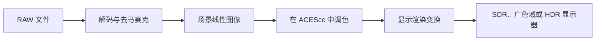
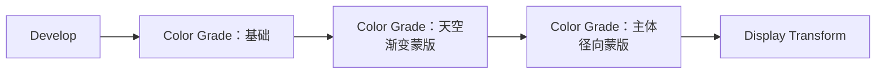

<p align="center">
  
</p>

<p align="center">
  <a href="https://aoraw.org/zh-cn/">项目网站</a> · <a href="https://aoraw.org/">Project website</a> · <a href="https://zidage.github.io/AlcedoStudio_docs/docs/intro">文档</a> · <a href="https://github.com/zidage/AlcedoStudio/releases/tag/v0.3.3">下载 v0.3.3</a>
</p>

<p align="right"><a href="./README.md">English</a> | <a href="./README.zh-CN.md"><strong>简体中文</strong></a></p>


-lightgrey)

**Alcedo Studio** 是一款免费、开源的 RAW 编辑器与照片图库。

将照片导入后，你可以在统一的项目中浏览、评分、检索，并通过全链路 32 位浮点 GPU 管线冲洗 RAW 图像，即使面对高像素中画幅文件也能流畅编辑。相册结构和每张照片的完整编辑历史都保存在同一个项目文件里，移动或备份它就像处理任何普通文件一样。

支持 Windows 10/11（x64，CUDA/OpenCL）和搭载 Apple Silicon 的 Mac（Metal）。

<p align="center">
  
</p>

<details>
<summary><strong>演示视频</strong>（两段短视频）</summary>

编辑器

https://github.com/user-attachments/assets/d70cd10d-2045-42f3-a67d-97ab3ef9874b

图库

https://github.com/user-attachments/assets/ae0d9773-220e-4901-90f6-1989f58b0462

</details>

## 核心特性

- **场景参考的节点式色彩管线**  
  全链路基于 32 位浮点场景线性空间，内置 ACES 2.0 与 OpenDRT 显示渲染变换。调色过程组织为直观的节点图：`Develop` 节点完成 RAW 解码与色彩空间转换，后续可串联任意数量带独立蒙版的 `Color Grade` 节点。支持 113 款胶片 LUT 及任意色彩空间的自定义 3D CUBE LUT。

- **基于 DAG 的 GPU 交互管线**  
  调色处理采用有向无环图（DAG）架构，全链路基于原生 CUDA / OpenCL（Windows）与 Metal（macOS）的 32 位浮点计算。每个节点与蒙版独立缓存中间结果，调整滑块时只重算后面的变化，而不需要从头重跑整张照片。拖动时即时响应，松开后自动呈现完整画质；放大查看时也仅对当前屏幕区域渲染 1:1 细节，处理高像素大文件完全不需要等待漫长的离线代理。

- **轻量本地图库（DuckDB + 本地 CLIP）**  
  相册数据直接由内嵌的 DuckDB 驱动，在海量图库下依然支持复杂的毫秒级条件筛选；结合本地运行的多语言 CLIP 模型，导入即可自动为照片生成语义标签，支持自然语言检索，全程零云端依赖。

- **类似 Git 的分支化历史**  
  每次修改都记录在非线性的版本树中，可随时从任意历史步骤切出新版本进行比对，所有操作均可永久撤销，并支持将 Look 局部或完整批量应用至其他照片。

- **1:1 的命令行与智能体协同**  
  图形界面中的每个交互（从筛片、调滑块到分支管理）在 `alcedo-cli` 中均有对应命令。配合 [alcedo-skills](https://github.com/zidage/alcedo-skills)，Claude Code 或 Codex 等智能体可以在后台批量处理，或在当前窗口中协同调色，将静态预设转变为能理解画面内容的动态脚本。

## 功能深入

### RAW 解码

Alcedo 可以读取 Canon、Nikon、Sony、Fujifilm、Panasonic、OM System、Leica、Hasselblad、Phase One（包括 1.5 亿像素的 IQ4）、Pentax、Sigma 的 RAW 文件，以及手机和无人机生成的 DNG，详见[支持的格式](docs/supported_raw_formats.md)和[支持的相机](docs/supported_cameras.md)。借助项目维护的 [LibRaw 分支](https://github.com/zidage/LibRaw)，它也能打开 Z 8、Z 9、Z 6 III 和 Z 50 II 拍摄的 Nikon 高效率（HE）NEF 文件。

它提供两种去马赛克方法。Bayer 传感器默认使用 RCD；Fujifilm X-Trans 默认使用 Neural Engine，这是一个从 [DemosaicNet](https://groups.csail.mit.edu/graphics/demosaicnet/) 蒸馏而来、在 GPU 上运行的精简神经网络，同样适用于 Bayer 文件。Alcedo 还支持基于 darktable 与 RawTherapee 的 inpaint-opposed 方法改进而来的高光重建、基于 Lensfun 配置文件的镜头校正，以及 DNG 文件内嵌的色彩配置文件。

### 场景参考的色彩管线

Alcedo 在整个编辑过程中保留 RAW 文件的全部动态范围，只在最后一步为你的显示器形成画面：



显示渲染变换可以选择 ACES 2.0 输出变换或 OpenDRT，并设置目标色彩空间、传递函数和峰值亮度。在配备 HDR 显示屏的 Mac 上，编辑器可以直接预览 HDR 效果。

### 基于节点的调色

每张照片的编辑都是一张节点图。Develop 节点把 RAW 转换为场景参考图像，之后可以依次串联任意多个 Color Grade 节点，最后由 Display Transform 节点形成最终画面。每个 Color Grade 节点都有自己的调整和蒙版，因此一次调色既可以作用于整个画面，也可以只作用于你选定的区域。



每个节点内都有常用的影调和色彩控制、色调曲线、Lift/Gamma/Gain 色轮、可选颜色和细节工具，阴影与高光由局部色调映射处理。Alcedo 还内置了[根据真实胶片光谱响应生成的 CUBE LUT](https://github.com/JanLohse/spectral_film_lut)，以及基于物理模型的胶片颗粒和光晕。

### 任意色彩空间的 LUT

除了官方胶片 LUT 包，你也可以使用自己的 3D CUBE LUT：把它们放进 LUT 浏览器提示的用户 LUT 文件夹，它们就会出现在“User”分类下。你可以为每个 LUT 选择它期望的输入编码和它产生的输出编码。场景编码包括 ACES、ARRI LogC3 和 LogC4、Fujifilm F-Log、Panasonic V-Log、Nikon N-Log、Apple Log 和 DaVinci Intermediate；显示编码包括 sRGB、BT.1886、PQ 和 HLG。当 LUT 输出的是显示编码时，Alcedo 会用 ACES 2.0 逆输出变换把结果带回场景空间，让这个 LUT 像其他调整一样在场景参考管线中工作。Alcedo 可以记住某个 LUT 的编码组合，每次使用时自动应用；把调整复制到其他照片时，也会一并带上这些编码。LUT 浏览器可以按分类、来源、品牌和印片筛选。

### 版本与编辑历史

每张照片可以保存多个命名版本，你也可以从历史中的任意一步分出新版本。每一次调整都会记录在类似 Git 的历史中，并保存在项目文件里，因此可以永远撤销。你还可以把完整的 Look，或只把其中你选中的部分，复制到其他照片上。实现原理请参阅[编辑历史设计说明](https://zidage.github.io/AlcedoStudio_docs/en/docs/developer/edit-history-architecture)。

### 图库与搜索

图库存储在 [DuckDB](https://duckdb.org/) 数据库中，照片越来越多时，浏览、筛选和搜索依然流畅。相册检查器按拍摄日期、相机、镜头、标签和评分对照片分组，选中某个分组即可筛选相册。

Alcedo 支持三种搜索：按相机、镜头、日期、ISO、焦距和光圈进行 EXIF 搜索；使用在本地运行的多语言 CLIP 模型进行自然语言搜索，这些模型也可以在导入后自动为照片打标签；以及对 Alcedo 生成的描述和标签进行全文搜索。

它还可以通过兼容 OpenAI 或 Anthropic 的接口，连接你已经在使用的 AI 服务，为每张照片撰写描述，并给出 1–5 星评分和简短理由。评片的严格程度和使用的语言都可以设置。API 密钥保存在 Windows 凭据管理器或 macOS 钥匙串中，分析在后台运行，不影响你继续工作。

### 导出

Alcedo 可以导出 JPEG、PNG、TIFF、OpenEXR 和 Ultra HDR JPEG，并根据格式支持 8、16 或 32 位。它支持按长边、像素尺寸或打印尺寸设置大小，嵌入 ICC 配置文件，并用源文件名、拍摄日期、相机、镜头、曝光参数、评分和序号组合文件名。导出预设（Standard、Web、Social Media、Email、Maximum Quality JPEG、16-bit TIFF 和 EXR Archive）会设置除目标位置以外的所有选项，你也可以保存自己的预设。每次导出都可以选择是否保留源照片的 EXIF 元数据、ICC 配置文件和 GPS 定位。相机与镜头序列号以及编辑历史永远不会写入导出的文件。

### AI 智能体与 alcedo-cli

alcedo-cli 安装在应用程序旁边（macOS 上位于应用包内）。无论是智能体、脚本，还是在终端里操作的你，都能通过它做到界面能做的事：

- **项目与图库**：创建、打开和保存项目；导入文件夹；列出、评分、选择和删除照片；读取拍摄元数据和缩略图；并按搜索对话框的规则搜索，包括自然语言搜索。
- **编辑**：打开照片，读取和设置编辑器中的任意调整，一步设置多个字段，操作节点和 LUT，撤销与重做，读取编辑历史。
- **版本**：创建、分支、切换、重命名和删除版本，在照片之间复制和粘贴调整。
- **输出**：渲染预览供智能体查看，使用与导出面板相同的选项导出，并跟踪后台任务直到完成。

智能体有两种工作方式。无窗口会话在后台运行，适合批量任务。智能体也可以接管你正在使用的窗口：在它控制期间，你的编辑控件会被锁定，但仍然可以平移、缩放和查看示波器。智能体会话固定在任务岛和后台任务对话框的顶部，并列出它执行的操作；点击 Stop 会立即结束它的控制。智能体的编辑会在历史中标出，并显示它留下的说明，方便你逐条检查或撤销。

```sh
alcedo-cli session start --headless --project <项目>.alcd
alcedo-cli call search.query '{"text": "海边的日落"}'
alcedo-cli schema          # 每个命令的参数和结果
alcedo-cli session stop
```

配合 [alcedo-skills](https://github.com/zidage/alcedo-skills) 仓库中的 `alcedo` 技能，智能体可以形成「渲染预览 → 观察画面 → 调整参数」的闭环，根据实际画面内容动态调整，而非机械套用固定预设。安装时，直接对智能体说“Install the skill zidage/alcedo-skills”即可；在 Claude Code 中也可以运行 `/plugin marketplace add zidage/alcedo-skills` 和 `/plugin install alcedo@alcedo-skills`。新功能也不需要编译进二进制插件，编写轻量 Python 脚本即可直接与管线交互。例如，`contact_sheet.py` 通过一次批量调用为照片生成联系表用于挑选评分；`analyze_preview.py` 则从预览中测量影调、色偏与地平线倾斜，结果直接写回项目。完整的[命令参考](https://github.com/zidage/alcedo-skills/blob/main/skills/alcedo/references/README.md)（英文）在同一个仓库中。

## 截图

<table>
  <tr>
    <td width="50%"></td>
    <td width="50%"></td>
  </tr>
  <tr>
    <td width="50%"></td>
    <td width="50%"></td>
  </tr>
  <tr>
    <td width="50%"></td>
    <td width="50%"></td>
  </tr>
</table>

## 系统要求

- **Windows** 10 或 11，x64。计算能力 6.0 及以上的 NVIDIA GPU 使用 CUDA，其他 GPU 使用 OpenCL。
- **macOS** 13.3 或更高版本，Apple Silicon（M1 或更新），使用 Metal。
- 内存至少 8 GB，大型图库建议 16 GB 或以上。

## 文档

用户指南和开发者说明请见[文档网站](https://zidage.github.io/AlcedoStudio_docs/docs/intro)。从源码构建请参阅 [docs/build_from_source.md](docs/build_from_source.md)，各版本的更新说明位于 [docs/changelog/](docs/changelog/)。如需从终端、脚本或 AI 智能体控制 Alcedo Studio，请参阅 [alcedo-cli 文档](https://github.com/zidage/alcedo-skills/blob/main/skills/alcedo/references/README.md)（英文）。该文档属于 [alcedo-skills](https://github.com/zidage/alcedo-skills) 仓库中的智能体技能。

## 致谢

Alcedo Studio 基于许多开源项目及其作者的工作。

- 胶片模拟 LUT 来自 [JanLohse/spectral_film_lut](https://github.com/JanLohse/spectral_film_lut) 和 [andreavolpato/spektrafilm](https://github.com/andreavolpato/spektrafilm)。
- 部分相机色彩矩阵来自 [rawtoaces-data](https://github.com/AcademySoftwareFoundation/rawtoaces-data)。
- 神经网络去马赛克模型蒸馏自 [mgharbi/demosaicnet](https://github.com/mgharbi/demosaicnet)（[Gharbi 等，2016](https://groups.csail.mit.edu/graphics/demosaicnet/)）。
- Inpaint-opposed 高光重建改编自 [darktable](https://github.com/darktable-org/darktable/blob/master/src/iop/hlreconstruct/opposed.c) 和 [RawTherapee](https://github.com/RawTherapee/RawTherapee/blob/dev/rtengine/hilite_recon.cc)。
- RCD 去马赛克改编自 [LuisSR/RCD-Demosaicing](https://github.com/LuisSR/RCD-Demosaicing)。
- OpenDRT 移植自 Jed Smith 的 [open-display-transform](https://github.com/jedypod/open-display-transform)。
- ACES 2.0 输出变换依据 [aces-aswf/aces-core](https://github.com/aces-aswf/aces-core) 实现。
- 胶片颗粒基于 [Realistic Film Grain Rendering](https://doi.org/10.5201/ipol.2017.192)（IPOL 2017）。
- RAW 解码使用 [LibRaw](https://www.libraw.org/)，镜头校正使用 [Lensfun](https://lensfun.github.io/)，元数据使用 [Exiv2](https://exiv2.org/)，图像读写使用 [OpenImageIO](https://github.com/AcademySoftwareFoundation/OpenImageIO) 和 [OpenCV](https://opencv.org/)，色彩管理使用 [OpenColorIO](https://opencolorio.org/)，图库使用 [DuckDB](https://duckdb.org/)，界面使用 [Qt](https://www.qt.io/) 和 [QuickQanava](https://github.com/cneben/QuickQanava)。

完整的第三方组件及其许可证列表请参阅 [THIRD_PARTY_NOTICE.txt](THIRD_PARTY_NOTICE.txt) 和 [third_party_licenses/](third_party_licenses/)。

ACES 是美国电影艺术与科学学院（A.M.P.A.S.）的商标。Alcedo Studio 是独立项目，与 A.M.P.A.S.、Academy Software Foundation、Jed Smith 以及上文提到的其他上游作者均无关联，也未获得其认证或背书。文中提及这些名称仅用于标明相应的技术。

## 许可证

Alcedo Studio 使用 GNU 通用公共许可证 v3.0（GPL-3.0-only）。请参阅 [LICENSE](LICENSE) 和 [NOTICE](NOTICE)。
